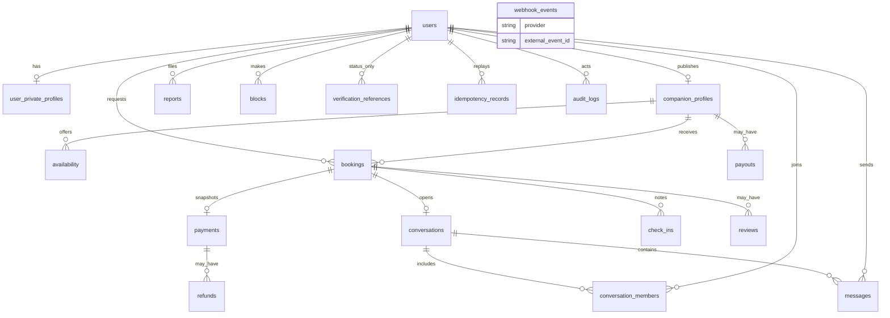

# ER diagram

Identifiers are UUIDs. Timestamps are `timestamptz` and meant to be UTC. Money is an integer of minor units plus a 3-letter currency. The partial exclusion constraint on bookings is drawn as a note because it is not a foreign key.

`bookings` also has `EXCLUDE USING gist` on `(companion_profile_id, tstzrange(starts_at, ends_at, '[)'))` where status is `accepted` or `hold`. `availability` has the same exclusion without a status filter. `webhook_events` is unique on `(provider, external_event_id)`. `idempotency_records` is unique on `(actor_user_id, idempotency_key)`.

See [data-dictionary.md](data-dictionary.md) for columns and the checks that are not in the diagram.
